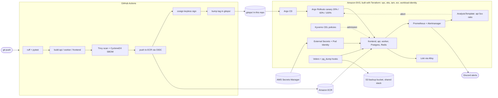
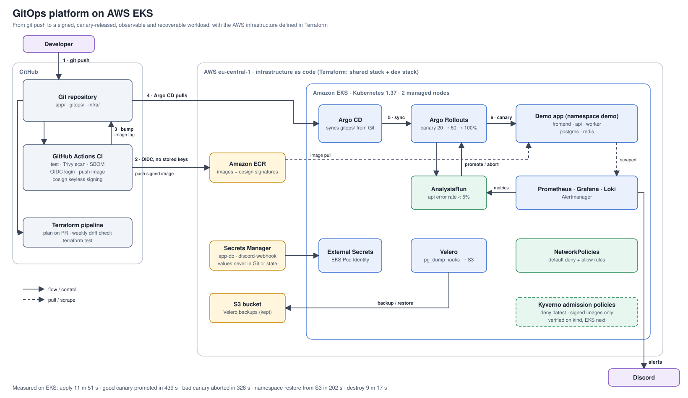

# GitOps platform on AWS EKS

[](https://github.com/Islem-rb/gitops-eks-platform/actions/workflows/app.yml)
[](https://github.com/Islem-rb/gitops-eks-platform/actions/workflows/iac-test.yml)

A production-style delivery platform, built end to end: **a `git push` becomes a signed container image, is released to Kubernetes as a canary, is checked against live metrics, rolls itself back when it is bad, and can be restored after a disaster.** The AWS infrastructure is defined in Terraform and was created and destroyed in budgeted sessions on a free-plan account.

The workload is a small job-queue app (frontend, api, worker, Postgres, Redis). The app is deliberately simple; the platform around it is the project.

Portfolio write-up: [islem-rb.github.io/projects/gitops-eks-platform](https://islem-rb.github.io/projects/gitops-eks-platform)

## Architecture



The detailed diagram is in [docs/architecture/architecture.svg](docs/architecture/architecture.svg):



<!-- TODO screenshot: Argo CD application tree for demo-eks (docs/screenshots/argocd.png) -->
<!-- TODO screenshot: Argo Rollouts canary aborted by the analysis (docs/screenshots/rollout-aborted.png) -->
<!-- TODO screenshot: Grafana platform SLO dashboard (docs/screenshots/grafana-slo.png) -->

## Tech stack

| Area | Tools |
|---|---|
| Cloud | AWS: VPC, EKS (Pod Identity, EBS CSI, VPC CNI network policies), ECR, IAM, KMS, S3, Secrets Manager |
| Infrastructure as code | Terraform (5 local modules, `terraform test` with mocked providers), TFLint, Checkov |
| CI and supply chain | GitHub Actions with OIDC, Trivy, CycloneDX SBOM, cosign keyless signing, Dependabot |
| Delivery | Argo CD, Argo Rollouts, Kustomize |
| Observability | kube-prometheus-stack (Prometheus, Grafana, Alertmanager), Loki, Alloy, k6 |
| Security and recovery | Kyverno (CEL policies), NetworkPolicies, External Secrets, Velero |
| Workload | Python (FastAPI api, worker), nginx frontend, Postgres 16, Redis 7 |

## Measured results

All numbers come from two real EKS sessions (eu-central-1, Kubernetes 1.37, 2 x `m7i-flex.large`) on 2026-10-24 and 2026-10-25. Raw table: [docs/RESULTS.md](docs/RESULTS.md).

| What | Result |
|---|---|
| `terraform apply`: VPC, EKS, add-ons, Pod Identity roles (41 resources) | 11 min 51 s |
| Bootstrap: Argo CD, Argo Rollouts, 8 applications | 1 min 16 s, all Synced/Healthy about 5 min later |
| Good release (canary 20% → 60% → 100%) | promoted in 439 s, 8/8 analysis measurements at error rate 0 |
| Bad release (50% injected failures) | **aborted automatically**, in 328 s and in 245 s on two runs; measured 0.41/0.38 and 0.43/0.42 against a 0.05 threshold; stable pods kept serving |
| Namespace deleted, restored from S3 with Velero | data restored every time; app serving again in 204 s and 198 s on two runs, after a DNS problem that needed a CNI agent restart (open, see [ADR 0004](docs/adr/0004-dns-failure-after-namespace-restore-on-eks.md)) |
| `terraform destroy` and leftover check | 9 min 17 s, nothing left billing |
| Cost of the two sessions | about 2 h 15 min and 1 h 15 min of cluster time, roughly $2 in total (estimate from hourly prices) |

## What it does

**Infrastructure as code (Terraform)**
- Modules: `vpc`, `eks`, `ecr`, `iam`, `workload-identity`. Environments: `bootstrap`, `shared`, `dev` (applied), `staging` and `prod` (plan-only, never applied).
- Remote state in S3 with native locking. Input validation, and `terraform test` with mocked providers for the modules.
- A read-only plan pipeline runs on pull requests and weekly to detect drift. It uses its own least-privilege role.
- EKS uses Pod Identity, the EBS CSI driver and VPC CNI network policies. Cluster secrets are encrypted with a KMS key.

**CI and supply chain (GitHub Actions)**
- Tests, then a build matrix for api, worker and frontend: Trivy scan, SBOM, push to ECR.
- AWS access through GitHub OIDC with tightly scoped roles. No long-lived keys anywhere.
- Images are signed with cosign keyless signing. A step verifies the signature before signing, so rebuilding an unchanged digest is safe.
- A final job bumps the image tag in `gitops/` with a bot commit. That commit touches only `gitops/**`, so it cannot trigger a loop.

**GitOps and progressive delivery**
- Argo CD syncs everything from Git, including itself, monitoring, backups and policies.
- Argo Rollouts runs a canary (20% → 60% → 100%). An AnalysisTemplate queries Prometheus for the api error rate and aborts the rollout when it passes 5%.
- `scripts/release.sh` drives a release (or a deliberately bad one) and prints the analysis measurements.

**Observability**
- kube-prometheus-stack, Loki and Alloy, a generated Grafana dashboard, and Alertmanager alerts delivered to Discord.
- Runbooks for the alerts: [`docs/runbooks/`](docs/runbooks).

**Security and policy**
- NetworkPolicies: default deny ingress plus explicit allow rules per service.
- Kyverno (CEL policies) denies `:latest` tags and workloads without resource limits in the app namespaces. An image-signature policy runs in audit mode first, by design ([ADR 0003](docs/adr/0003-image-signature-policy-audit-first.md)).
- Secrets live in AWS Secrets Manager and reach the cluster through External Secrets with Pod Identity. Values were created from the CLI, so they are in neither Git nor Terraform state.

**Backup and recovery**
- Velero with pg_dump backup and restore hooks, sending backups to S3. Why dumps and not volume snapshots: [ADR 0002](docs/adr/0002-postgres-backups-with-pg-dump-hooks.md).
- `scripts/restore-drill.sh` deletes the namespace, restores it, and verifies the data in Postgres directly and through the API. Runbook: [restore-namespace-from-backup](docs/runbooks/restore-namespace-from-backup.md).

## Problems I had to solve

These are real failures from building it, not a polished story:

- **After a restore on EKS, the restored pods could not resolve DNS.** The data was back, but the app was down until the VPC CNI agent on that node was restarted. It happened on both EKS restores I checked with a valid detector (the first I confirmed by hand and it lasted over ten minutes); kind does not show it. My first detector was wrong (a BusyBox `nslookup` exit-code quirk gave false alarms), which I only caught by testing it on a healthy cluster. The restart is a mitigation, not an explanation: the root cause is open in [ADR 0004](docs/adr/0004-dns-failure-after-namespace-restore-on-eks.md). An early version of the drill also reported a false `DATA LOST`, because it checked through the API instead of the database.
- **cosign refused to re-sign an unchanged image digest** (`TAG_INVALID`). Fixed by verifying before signing.
- **OIDC trust failed in CI** until the role trust policy matched GitHub's immutable subject claims and the IAM policy included `ecr:GetDownloadUrlForLayer`.
- **Velero's volume backup captured nothing on kind** because the volumes were `hostPath`. Replaced with application-consistent pg_dump hooks.
- **EKS 1.37 has no in-tree EBS provisioner**, so the default `gp2` class could not provision volumes. Added the EBS CSI add-on and a `gp3` default class.
- **A near-miss with an empty Terraform variable** on a fresh machine. Added input validation and a committed `terraform.tfvars.example`.

## Repository layout

```
app/                 api, worker, frontend (the demo workload)
infra/
  modules/           vpc, eks, ecr, iam, workload-identity (with terraform tests)
  envs/              bootstrap, shared, dev, staging, prod
gitops/
  argocd/            Argo CD Applications (kind and EKS variants)
  apps/              demo (kustomize base + overlays), monitoring-config, policies, platform-eks
scripts/             eks-bootstrap.sh, eks-teardown.sh, release.sh, restore-drill.sh
tests/load/          k6 load test
docs/                RESULTS.md, architecture/, adr/, runbooks/
.github/workflows/   app.yml (CI), iac-plan.yml, iac-test.yml, iac.yml
```

## Run it

**The app alone, with Docker Compose.** Builds the api, worker and frontend and starts them with
Postgres and Redis (from `docker-compose.yml`): frontend on http://localhost:8081, api on
http://localhost:8000 (`/healthz`, `/jobs`), worker metrics on http://localhost:9100/metrics.

```bash
docker compose up --build
```

**The checks CI runs.**

```bash
pip install ruff pytest httpx -r app/api/requirements.txt -r app/worker/requirements.txt   # Python 3.12, as in CI
ruff check app/
pytest app/api/tests -q

# Terraform module tests (mocked provider, no AWS access needed)
for m in iam ecr vpc; do (cd infra/modules/$m && terraform init -backend=false && terraform test); done
```

**Locally on kind (free).** The Argo CD Applications for the kind variant are in `gitops/argocd/` (`demo-kind.yaml`, `monitoring.yaml`, `loki.yaml`, `kyverno.yaml` and the others).

**On EKS (one budgeted session, about $0.50 per hour).**

```bash
# 1. infrastructure (about 12 minutes)
cd infra/envs/dev
cp terraform.tfvars.example terraform.tfvars   # set public_access_cidrs to your IP/32
terraform init && terraform apply

# 2. create the two secrets once (values never go into Git)
aws secretsmanager create-secret --name platform/app-db --secret-string '{"username":"app","password":"<generated>","database":"app"}'
aws secretsmanager create-secret --name platform/discord-webhook --secret-string '<webhook-url>'

# 3. bootstrap Argo CD, Rollouts and all applications
cd ../../.. && ./scripts/eks-bootstrap.sh

# 4. exercise it
./scripts/release.sh v2 0          # good release: promoted
./scripts/release.sh v3-bad 0.5    # bad release: aborted by analysis
ARGO_APP=demo-eks ./scripts/restore-drill.sh

# 5. tear everything down and verify nothing is left
./scripts/eks-teardown.sh
```

The Velero backup bucket lives in the permanent `shared` stack, so backups survive cluster teardown.

## Decisions

[0001 record decisions](docs/adr/0001-record-architecture-decisions.md) · [0002 Postgres backups with pg_dump hooks](docs/adr/0002-postgres-backups-with-pg-dump-hooks.md) · [0003 image-signature policy, audit first](docs/adr/0003-image-signature-policy-audit-first.md) · [0004 DNS failure after a namespace restore on EKS (open)](docs/adr/0004-dns-failure-after-namespace-restore-on-eks.md)

## What I learned

- **A detector has to be tested on a healthy system first.** My first DNS check after a restore
  raised false alarms, and an early restore drill reported data loss that never happened. Both
  looked like platform bugs until I ran them where nothing was wrong.
- **Measure, then write it down.** Every number in this README comes from a run recorded in
  `docs/RESULTS.md`, and the cases that went wrong are kept there too.
- **Keyless signing and OIDC remove a whole class of secrets**, but the trust policies and IAM
  permissions have to be exact; most CI failures came from there, not from the build.
- **kind and EKS differ in ways that matter**: storage provisioning (`hostPath` vs EBS CSI) and
  the DNS failure after a restore only show up on one of them.

## What I'd improve next

Taken from the limits below:

- Apply `staging` and `prod`, not just plan them.
- Enforce image-signature verification on EKS once registry credentials come through Pod Identity.
- Find the root cause of the DNS failure after a restore (ADR 0004) instead of restarting the CNI agent.
- Add an ingress with DNS and TLS instead of `kubectl port-forward`.
- Automate secret rotation, and replace the single Postgres pod with a replicated database.

## Limits and what is not done

Stated plainly, because they matter:

- **One live environment.** `staging` and `prod` are validated and planned in CI but have never been applied.
- **Image-signature enforcement is not enabled on EKS.** Signing and verification work and the policy was proven in audit mode on kind. Enforcing it on EKS needs registry credentials delivered through Pod Identity first.
- **Postgres is a single pod** with dump-based recovery, not a replicated database. Recovery time is minutes, not seconds.
- **No ingress, DNS or TLS.** The UIs are reached with `kubectl port-forward`.
- **A DNS failure after a restore on EKS** reproduced on a second session; it is mitigated by a restart but its root cause is not known.
- **Secret rotation is not automated.**
- **Cost figures are estimates** from hourly prices, not billing data.
